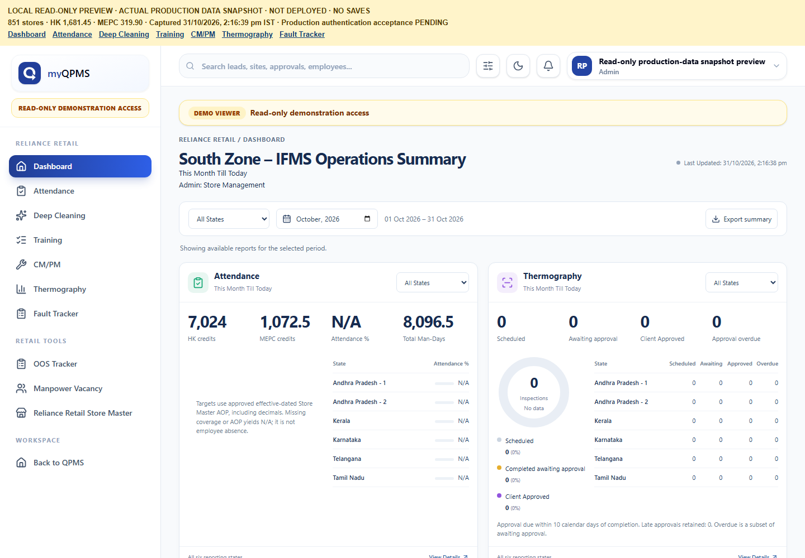
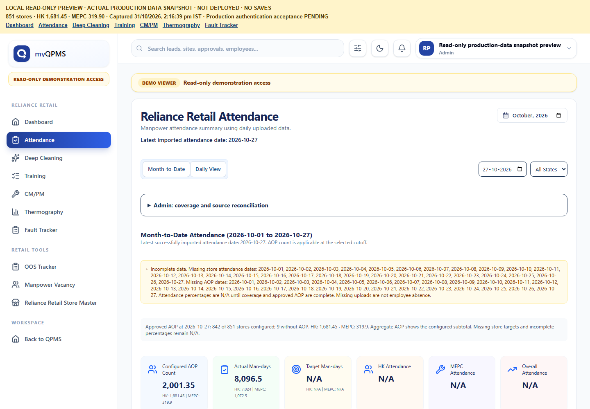
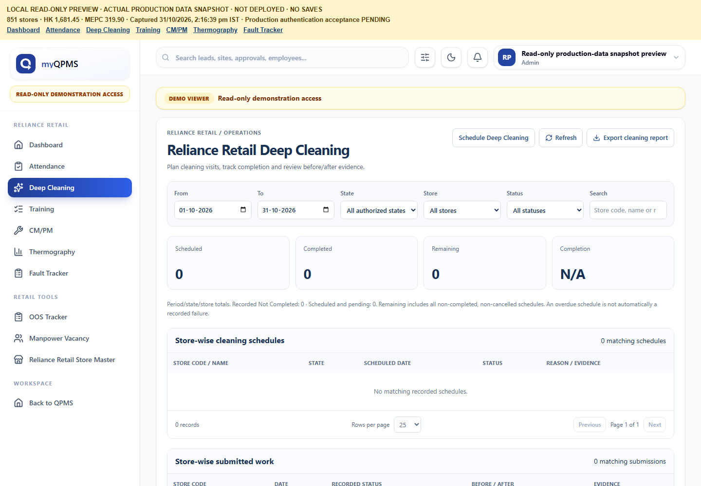
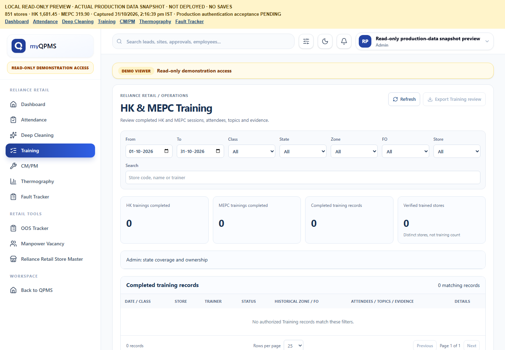
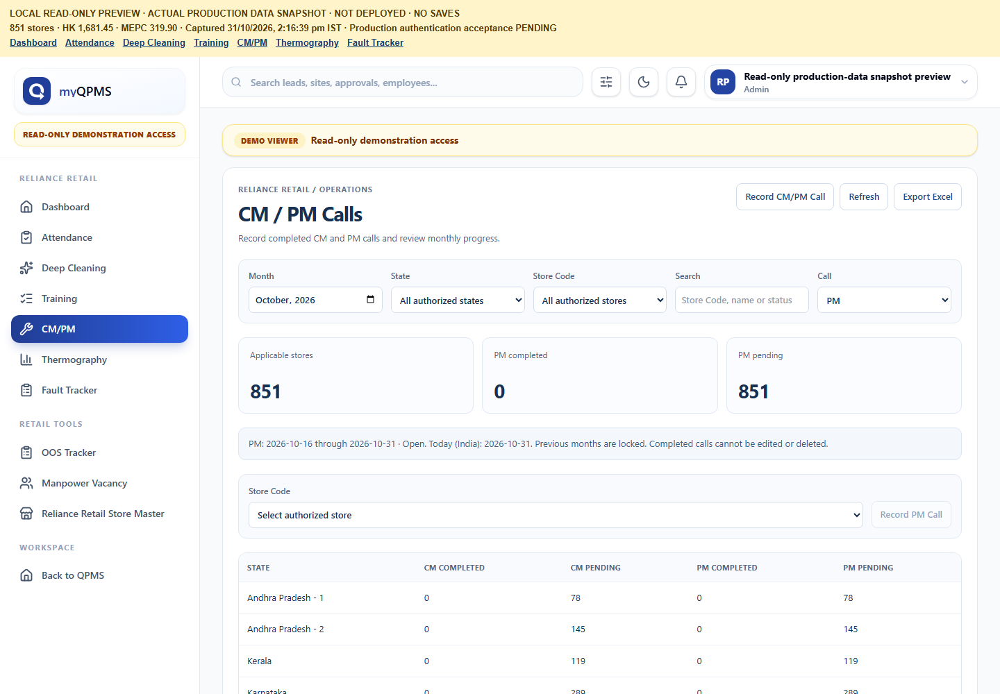
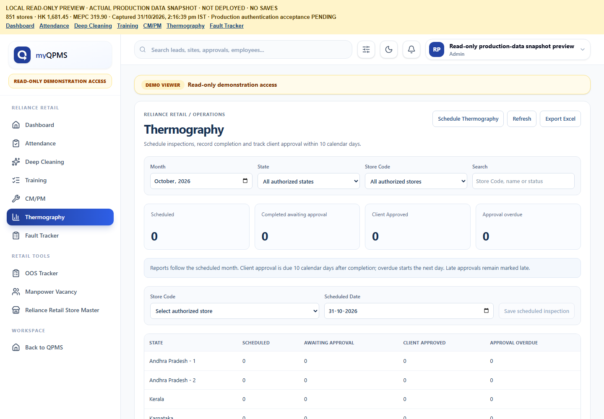
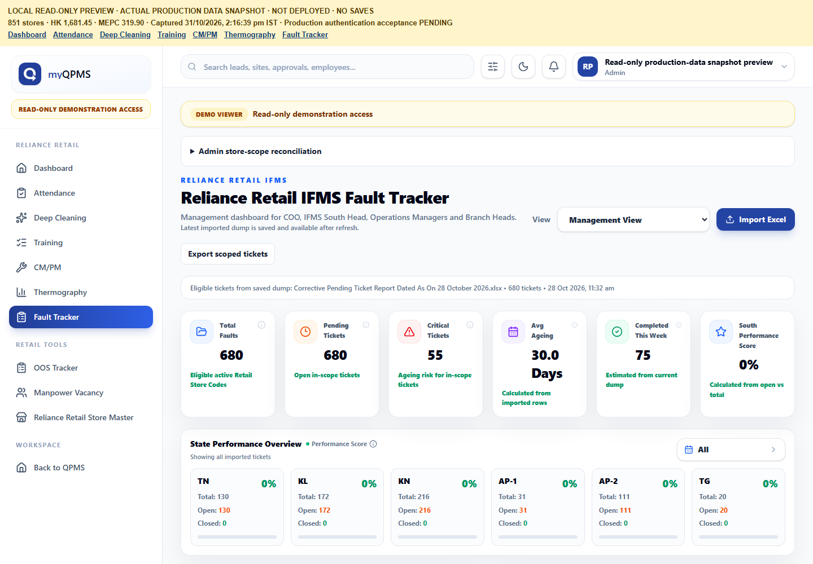
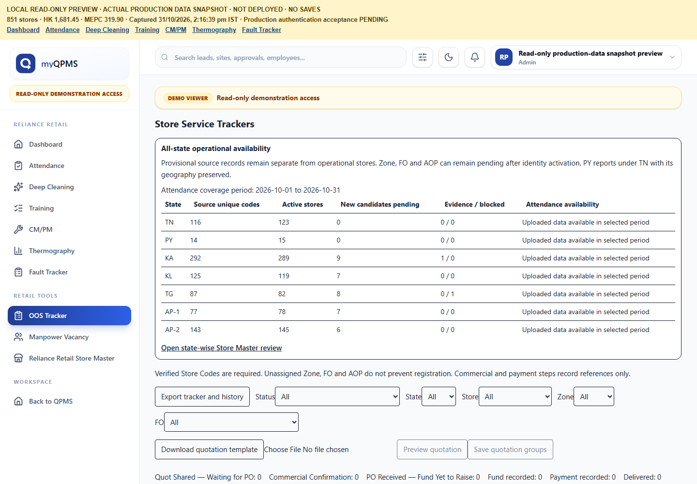
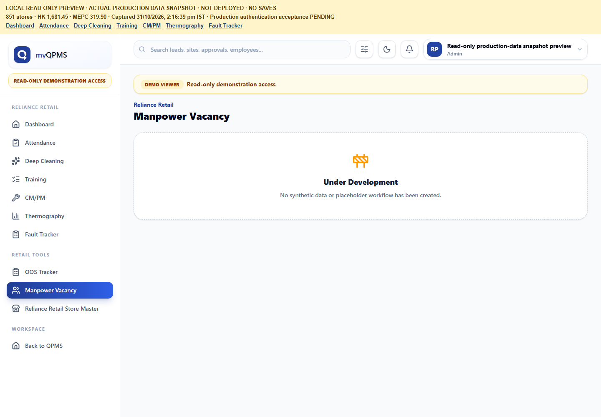
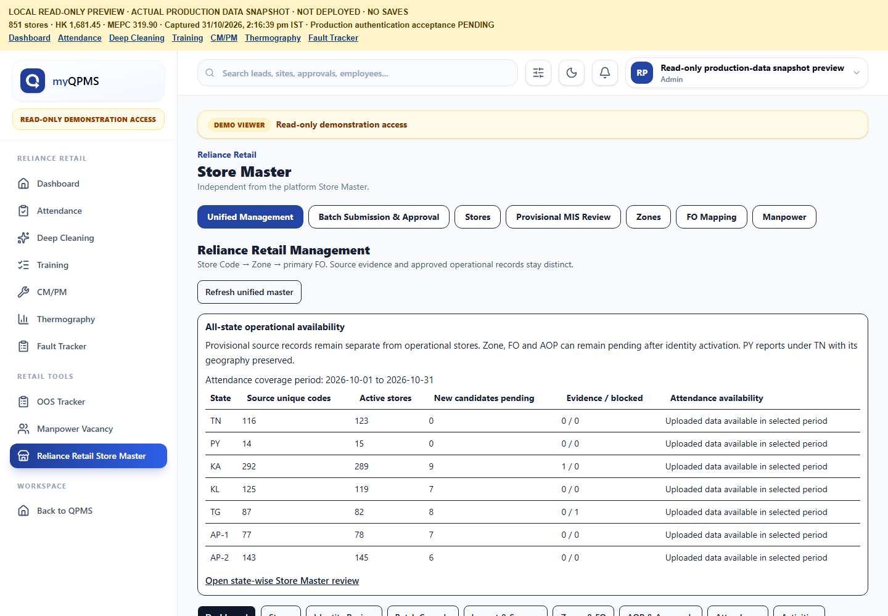

# Reliance Retail: practical user manual

Reviewed 31 October 2026 against committed candidate `0a9da9135357aa28eb83a3bf55d0ce5d3ea5e9b2`.

**Read this first:** the screenshots are actual application screens at the **local read-only production-data snapshot preview**, not authenticated live-production acceptance. Its banner says **NOT DEPLOYED · NO SAVES**. Do not use it to prove a save. The candidate's authenticated production workflows are **NOT VERIFIED IN PRODUCTION**. Obtain your existing authorized login; never borrow another user's password. New MIS accounts/state permissions still require configuration by the authorized administrator. Training authoring remains FO-only.

Use [the role matrix and action audit](WORKFLOW_AUDIT_MATRIX.md) when a button or record is unavailable. Missing permissions, incomplete data and unavailable services are not zero results. This manual does not authorize uploads, imports, approvals or production test records.

## 1. Open the Retail workspace

1. Sign in through the normal approved application login using your own account.
2. Open **Reliance Retail → Dashboard**. The dedicated workspace lists **Dashboard**, **Attendance**, **Deep Cleaning**, **Training**, **CM/PM**, **Thermography**, **Fault Tracker**.
3. **Retail tools** contains **OOS Tracker**, **Manpower Vacancy**, and **Reliance Retail Store Master**. Only permitted links are shown. **Back to QPMS** leaves the workspace.
4. Select the relevant month/state/store before interpreting totals. Tamil Nadu reporting includes Puducherry where the report mapper specifies it; source geography remains separate. Karnataka can appear as KA or KN; AP-1 and AP-2 remain distinct.
5. After a real permitted save, refresh and reopen the record. A changed screen or a local preview is not proof of persistence. Record the displayed error if the request fails; do not reimport data to repair a display issue.

## 2. Dashboard: read operational summaries

1. Open **Dashboard**. Set **Reporting month** and the top state selector. Individual cards also have a state selector; a global state limits those choices.
2. Read **Attendance**: **HK credits**, **MEPC credits**, **Attendance %**, **Total Man-Days**. Credits are uploaded attendance units, not necessarily unique people. Percentage needs complete attendance and approved AOP coverage; otherwise it is N/A.
3. Read **Thermography**: **Scheduled** = not yet completed, **Awaiting approval** = completed, **Client Approved** = approved, **Approval overdue** = a subset of completed work awaiting approval beyond its due date. These status counts are not a Normal/Abnormal scan classification.
4. Read **CM Calls** and **PM Calls**: applicable stores, completed, remaining and completion percentage for their respective monthly windows. A recorded completion reduces pending; a training topic does not count as a maintenance call.
5. Read **Deep Cleaning**: scheduled, completed, remaining and completion %. Cancelled schedules are excluded. Recorded Not Completed and scheduled/pending are explained separately; overdue is not automatically a failed visit.
6. Read **MEPC Training** and **HK Training**: completed session counts. **Total stores** is authorized inventory, not the number of stores trained. One store can have multiple sessions.
7. Use **View Details** on a card to open its detailed report. Use **Export summary** for the selected global/card scope. A module marked unavailable has no confirmed total; do not replace it with zero in external reports.
8. Fault Tracker is opened from its navigation link; there is no separate Fault Tracker KPI card on this Dashboard.

This page does not create, edit or delete operational records.

## 3. Attendance: upload, review and report

### Prepare and validate an authorized upload

1. Only an authorized administrator can upload/correct attendance in the current backend. HK MIS/Technical MIS should send an approved workbook to that administrator rather than assume their reporting access permits import.
2. Use the existing M-here `.xlsx` source, maximum **15 MB**. Keep the required headers **EP No**, **EP Name**, **Site Code**, **Att. Date**, **Att. Status**, **Class**. EP No and Site Code are identifiers; retain leading zeros. Use recognized store codes, valid dates and HK/MEPC classes; do not substitute a store name for its code.
3. Recognized status credits are **P / H-P = 1**, **HD / H-HD = 0.5**, **A / T / H / NO-SHOW = 0**. Unknown statuses are rejected. A missing upload does not establish employee absence.
4. Open **Attendance → Upload Day Attendance**. Select/drop the workbook; choose **Validate and Preview**. Validation also retains source/audit evidence; it is not an operational attendance import yet.
5. Review dates, valid/rejected/excluded counts and sample errors. Rejected rows receive no credit; excluded classes do not become HK/MEPC credits. Source/history exports retain the full source, not only displayed samples. Correct the source rather than inventing a code or status.
6. If the same employee/day already exists and the source differs, inspect the affected rows, tick **I confirm this correction**, enter **Correction reason**, then use **Confirm Correction**. Previous employee/day site rows are superseded together and retained in history. Do not use replacement for unrelated employee/days.
7. For an approved first import, use **Confirm Import** only after reviewing the preview. An identical already-imported file is reported without duplicating attendance. Wait for the response, refresh, and check the imported cutoff and history.

### Read and export

1. Choose **Month-to-Date** or **Daily View**, **Month and year**, **Attendance cutoff date** and **State filter**. The default cutoff comes from the latest imported date across bounded store batches.
2. Check configured HK/MEPC AOP subtotals and coverage. Decimal AOP is preserved. Missing store targets/coverage leave incomplete percentages N/A; configured subtotals are not a claim that every store is configured.
3. Review actual credits, targets or daily shortfall, and state-wise HK/MEPC percentages. MEPC uses the existing aggregate seven-day planning cycle; it does not assign individual weekly-off dates.
4. Select a state in **State-wise Summary**, then a store, then an employee attendance date to drill down. **Previous / Next** paginate employee rows.
5. **Total** exports consolidated results; **Export** exports state rows; **Store export** exports store rows. These are reporting exports, not permission to reimport AOP.
6. Permitted Admins can open **Import history and exceptions → Source and exceptions → Export source and exceptions**. This is the retained audit/replacement source. The Admin coverage/reconciliation panel is not a normal MIS entry form.

There is no ordinary row-delete workflow. Do not modify Store Master/AOP as an attendance-screen workaround.

## 4. Deep Cleaning: scheduling, approval and completion

### MIS schedule request and independent approval

1. Open **Deep Cleaning → Schedule Deep Cleaning**.
2. In **Store**, choose an active store permitted by your existing state editor/reviewer scope. The chosen code/name/state and available city/format appear automatically. If the required store is absent, stop and request scope review; do not select a substitute.
3. Enter **Scheduled date** and **Reason / approval reference** (3–2,000 characters).
4. Select **Submit schedule request**. A successful receipt means a proposal was saved **for independent review**, not that a live schedule already exists.
5. An existing independent reviewer opens **Reliance Retail Store Master → Unified Management → AOP & Approvals**, finds the `DC_SCHEDULE` proposal, selects **Approve review**, and supplies the decision/reference. The proposer cannot approve their own request. **Reject proposal** is the refusal path.
6. An authorized Admin selects **Apply approved operational change** for the approved proposal. The existing apply gate must allow it; approval alone does not open the gate. If blocked, stop and report the message. Do not change gates to finish a demonstration.
7. Refresh the Deep Cleaning report for the scheduled period/store and check the schedule row.

### FO before/after work: distinguish the two existing paths

The committed mobile UI has **Visits → Add Deep Cleaning Images** (also a **Deep Cleaning** task entry), **Before & After Photos**, **Add More Area**, per-area **Before / After**, and **Submit**. It persists through the legacy FO activity submission/upload service. The dedicated Retail report instead reads `client_deep_cleaning_submissions` and its uploads. **An end-to-end bridge between these paths is not established by this audit. Do not promise that the mobile Submit will automatically complete the new schedule report.**

For the committed legacy mobile flow:

1. Use your own assigned FO account and the existing authorized visit/activity context. Do not create an attendance/visit solely to test this manual.
2. Choose **Add Deep Cleaning Images** or the available **Deep Cleaning** task. Add the genuine **Before** and **After** images for each area; use **Add More Area** if needed. Enter available remarks.
3. Choose **Submit**, wait for completion, and check the existing activity record. The committed legacy implementation requires its existing remote attendance/visit context. This manual does not add or remove those rules.
4. Ask MIS to verify where the record appears. If it is only in legacy activity history and absent from the Retail report, report the integration gap; do not resubmit repeatedly or mark the schedule complete manually.

The dedicated authorized backend flow separately supports draft creation with store code/date, secure upload intents, upload completion and final submission. It requires at least **one before** and **one after** image, rechecks uploaded storage objects, and locks submitted work. Vendor name/remarks are optional. It is **not** a new browser FO capture form in the seven-module CRM, and its deployed mobile entry point is **NOT VERIFIED IN PRODUCTION**.

### MIS verification

1. Filter **From**, **To**, **State**, **Store**, **Status**, and **Search**.
2. A submitted dedicated completion for the same store/date matches its schedule. **Remaining = Scheduled − Completed**, excluding cancelled schedules. **Not Completed** is an explicit recorded status, not an automatic conversion of overdue work.
3. Use **Before / after evidence** on a linked schedule or **View evidence** under submitted work. Existing authorized temporary links open the recorded images/documents; do not forward links as public attachments.
4. Use **Export cleaning report**. Its schedule sheet follows the schedule status filter; recorded work is independently filtered. Unknown store identity is excluded with a notice, not silently guessed.

Desktop rescheduling, cancellation and a direct manual Not Completed action are not exposed by this report. Do not infer them from the presence of a database status.

## 5. Training: FO creation and HK/MEPC review

### FO structured authoring (committed UI; device/live acceptance pending)

1. Open the existing authorized Training flow, for example **Add Training Proof** from a visit. Select the appropriate HK or technical/MEPC category and an authorized active Retail store/Zone. Use the required existing attendance/visit context.
2. Enter **Trainer Name** and select the Training Type; review **Training Date** and optional **Remarks (optional)**. The current create service uses the server's India date; it is not an ordinary backdating control.
3. Use **Save Draft** or **Continue**. Add attendees through the available staff/attendee step, then choose the covered topics. Select **Continue with … topics**.
4. Add the evidence requested by the selected category/topic policy. Use **Review**, correct any validation errors, and choose **Submit Training**. Required topic/group/document evidence depends on that stored policy; do not assume every file category is always mandatory.
5. Reopen the saved session. The committed flow labels submitted/cancelled sessions read-only and offers **Done / View Next**. Draft evidence can be deleted where permitted; this is not permission to erase submitted audit history. Cancellation, when permitted by the existing owner/state rules, uses the established session cancel path rather than deleting the session.

QPMSADMIN and MIS **cannot author/edit/submit structured Training under current FO-only mutation checks**. Do not change a person's role to make a button work.

### MIS/Admin review

1. Open **Training**; select From/To, Class (HK/MEPC), State, Zone, FO, Store and Search.
2. Read **HK trainings completed**, **MEPC trainings completed**, **Completed training records**, **Verified trained stores**. Sessions and distinct stores are different counts. Unavailable ownership does not invent a trained-store count.
3. Choose **View Training evidence** to open the existing session details, employees/topics/history; choose **Get evidence link**, then **Open authorized evidence** where available.
4. Use **Export Training review**; it contains all filtered records, not just the current page. Pagination does not change the period totals.
5. Literal `MEPC MIS` is not an implemented role alias. The current Training web page recognizes HK MIS, not standalone Technical MIS. Account setup and the current technical-MIS reporting gap must be resolved explicitly; do not assume permission from the module title.

## 6. CM/PM: record a genuine completed call

1. Open **CM/PM** and select the reporting **Month**, State and Store filter as needed.
2. Select **Record CM/PM Call** at the top-right; it focuses the entry form. For the current month, the **Call** selector defaults from the server's India date: CM on days **1–15**, PM on days **16–month-end**. Selecting an earlier/upcoming call does not authorize a save outside its window.
3. In the entry **Store Code**, select the permitted active store. Review its displayed name, state and available city/format.
4. Choose **Record CM Call** or **Record PM Call** for work genuinely completed now. Review the confirmation; use **Cancel** to abandon or **Confirm save** to persist.
5. The server records actual completion date/time and user. A store/type/month can have only one completion. Refresh and check **Completed**, the completion date and **View history**.
6. Read applicable/completed/pending totals; change **Call** to review CM or PM. **Export Excel** includes state summary, store details for both kinds and audit history.
7. Previous months are locked; completed calls cannot be edited or deleted. Ordinary MIS cannot add a backdated completion, undo a completed call or reopen a month. Report mistakes to the authorized owner without fabricating a replacement record.

## 7. Thermography: schedule to client approval

1. Open **Thermography → Schedule Thermography**. It focuses the entry form.
2. Choose a permitted active **Store Code**, review the auto-displayed details, and enter **Scheduled Date**.
3. Choose **Save scheduled inspection → Confirm save**. A successful saved inspection is **Scheduled**. The report switches to its scheduled month when needed.
4. Open that month/store row. On or after the scheduled date, choose **Record completion → Confirm save**. The server records the actual completion date/user, changes status to **Completed**, and sets **Approval due** to completion date **+10 calendar days**. There is no user-entered actual-date/backdating field.
5. Once genuine client approval is received, choose **Record client approval → Confirm save**. The server records actual approval date/user and changes status to **Client Approved**.
6. The due date itself is on time; overdue starts the following day. An overdue approval remains saveable for an authorized user. **Approved late — retained** remains after approval; do not reset completion to conceal lateness.
7. Use Month/State/Store Code/Search, **View history**, and **Export Excel**. Reports group by scheduled month and show current status. Empty valid reports show zeros; unavailable/incomplete responses show unavailable and disable actions/exports.
8. Statuses move only Scheduled → Completed → Client Approved. Revision checks reject stale concurrent updates. No delete/backward transition is provided. If a record changed, refresh before acting again.

## 8. Existing IFMS Fault Tracker

1. Open **Fault Tracker**. It routes to the existing `/fault-tracker`, not the separate Store Fault Registration screen.
2. Permitted Admins can use the **View** selector to choose **Management View** or the Project Coordinator/MIS view. Other roles receive their default allowed view; do not assume a view selector grants a wider scope.
3. In Management View review **Total Faults**, **Pending Tickets**, **Critical Tickets**, **Avg Ageing**, **Completed This Week**, **South Performance Score**, State Performance Overview, Ageing Distribution, Pending Tickets by State, Supervisor Wise Pending Tickets, category alerts and Stage-wise Progress. Some measures, such as Completed This Week, are estimates from the imported snapshot, not a verified completion-event ledger. Use state/month controls to narrow and **Export scoped tickets** for that scope.
   Total Faults counts eligible scoped rows; Pending counts rows not classified closed; Avg Ageing averages imported ageing days; South Performance Score is the rounded closed-share percentage. **Completed This Week is currently `round(scoped total × 0.11)`, not an observed weekly completion count. Do not quote it as actual completed work.** This is a documented existing limitation, not a newly verified metric.
4. In the MIS view use **Detailed View** to expand rows. Filter State (where allowed), Supervisor, IFMS Stage, Ageing Bucket, Ticket Number, Store ID, Store Name, Created From/To, and **Search by any field…**. Use pagination and the available export control for the filtered data.
5. **Update** opens an existing ticket's IFMS Stage and Remarks. **Save currently changes browser state only in this committed component. It does not call a persistence API.** Do not use it as a reliable operational status update or audit receipt; refresh may discard the change. Persistent update is PARTIAL/MISSING even if the row visibly changes.
6. Admin **Import Excel** parses and sends the existing import request. This audit did not import anything. Do not reimport the 2,979-ticket source to fix a screen or test this manual.
7. The last read-only latest-import reconciliation is **680 eligible of 2,979 source tickets**, excluding 2,299 from operational scope. All source rows remain. Eligible rows match unique active Store Master codes and the existing role/state/store envelope. Additional user/filter scope can reduce 680. This is not a lifetime total across all import batches.
8. No ordinary source-ticket delete or persisted arbitrary status-history editor is supplied by this screen. Admin reconciliation is diagnostic; it does not approve excluded codes.

## 9. Retail tools: existing OOS Tracker

1. Open **Retail tools → OOS Tracker**. It displays **Store Service Trackers** locked to OOS, not the primary imported Fault Tracker.
2. Choose **Download quotation template**. Use sheet **Quotation** and exactly **Quotation Number**, **Store Code**, **Description**, **Quantity**, **Unit Rate**. Keep valid numeric quantities/rates and permitted known stores; do not use formulas/error cells. Each quotation group must remain within its allowed state.
3. Select the `.xlsx` workbook (service upload limit 10 MB); choose **Preview quotation**. Review validation, grouping and planned disposition. **Save quotation groups** uses the existing authorized import RPC; successful receipts/history distinguish replay from a new/reworked order. Do not execute an import solely for this manual.
4. Filter Status, State, Store, Zone and FO. Open **Quotation / fault details** to inspect recorded fields/history. **Export tracker and history** includes filtered orders, line items and related audit history.
5. Select the available next stage, fill its displayed required fields, then **Save tracker action**. Stages in code: QUOTED → PO_RECORDED → COMMERCIALLY_CONFIRMED → FUND_RECORDED → PAYMENT_RECORDED → DELIVERED. Display labels differ: **Quot Shared — Waiting for PO**, **Commercial Confirmation**, **PO Received — Fund Yet to Raise**, **Fund recorded**, **Payment recorded**, **Delivered**. Read the field prompt rather than infer a database stage from the label alone.
6. PO needs `po_number` and `po_date`; commercial confirmation needs `confirmation_ref`; fund/payment need `fund_ref`/`payment_ref`; delivery needs `delivery_ref` and `delivery_date`. Commercial confirmation requires an independent state reviewer, not the creator. Fund/payment actions record references; they do not transfer money or change ledgers.
7. Revised workbooks before PO use the existing rework path. Later-stage rework requires separately authorized V2 capability; **OOS V2 is postponed**. Split revised multi-quotation workbooks when the application requires individual revisions. Do not install SQL or bypass freezes/errors.
8. Technical MIS can see OOS navigation, but the backend OOS mutation check accepts OOS MIS/Admin, not Technical MIS alone. Role plus state editor/reviewer permissions and the runtime freeze govern actual saves. No general delete/backward-stage action is provided.

## 10. Retail tools: Manpower Vacancy

1. Open **Manpower Vacancy** where permitted.
2. The current page says **Under Development**. It has no vacancy creation, allocation, recruitment, Save, update, report, export, approval or history workflow.
3. Do not interpret Attendance shortfall or AOP as an implemented vacancy-management record. Ask the owner for the existing external process; this manual does not invent one.

## 11. Retail tools: Reliance Retail Store Master

1. Open **Reliance Retail Store Master → Unified Management**. This is the Retail master, separate from the platform Store Master.
2. Use the existing tabs: **Dashboard**, **Stores**, **Identity Review**, **Batch Console**, **Import & Sources**, **Zones & FO**, **AOP & Approvals**, **Attendance**, **Activities**, **Service Trackers**. Use the state/Zone/FO/store/date filters and available review exports. The outer **Batch Submission & Approval**, **Provisional MIS Review**, **Zones**, **FO Mapping** and **Manpower** tabs are different tools, not automatic authority.
3. For an authorized new identity proposal, use **Add Store → Save pending Store** with Store Code and Geographic State; Store Name is optional. This creates a pending source identity, not an active canonical store and not an attendance match.
4. In Unified **Stores**, use the permitted **Edit Store**, **Assign / Change Zone**, **Update HK AOP**, **Update MEPC AOP**, or **Plan Deep Cleaning** action. Review the proposed values and reason; choose **Submit independent review proposal**. Do not use this manual to alter the existing 851 stores or 842 configured AOP records.
5. Identity/Zone/FO changes require their actual form fields, explicit status/effective dates where applicable, and independent approval. HK/MEPC AOP changes require component values, explicit total, effective dates, calculation and approval references; a blank component/total is not assumed to be zero.
6. An independent permitted reviewer uses **Approve review / Reject proposal** in **AOP & Approvals**. A permitted Admin uses **Apply approved operational change** only after approval and while the existing gate permits it. New identity activation has its separate source-bound identity review/apply gates; it is not replaced by this generic button.
7. **Activities** reviews dated cleaning/training/schedules and historical ownership/evidence. Unknown historical ownership stays unknown. **Import & Sources / Batch Console** retain immutable source/version/review records; previewing, staging, approving and activating are distinct operations.
8. Legacy outer **Stores** Add/Edit controls may be visible, but the installed Unified workflow rejects direct master mutations and redirects users to reviewed proposals. Treat them as a legacy compatibility limitation, not a direct-write shortcut. No ordinary hard-delete workflow is provided.

## 12. Before escalating a problem

1. Record the page, date/month/state/store, button name and exact visible error. Do not include passwords, authorization headers, cookies, signed URLs or private photos in a shared ticket.
2. Check whether you are in the read-only local preview or real authenticated production. A preview's Admin-looking profile is not QPMSADMIN production acceptance.
3. If denied, ask for review of existing role/business/state/ownership configuration. Do not create duplicate accounts or broaden roles yourself.
4. If a Save claims success, refresh and reopen. Fault Tracker's current local-only Save is the explicit exception: it is not a persistent workflow.
5. Missing/partial items and evidence limits are listed in [the audit matrix](WORKFLOW_AUDIT_MATRIX.md). All production action acceptance remains NOT VERIFIED IN PRODUCTION until an authorized operator records the actual results.
